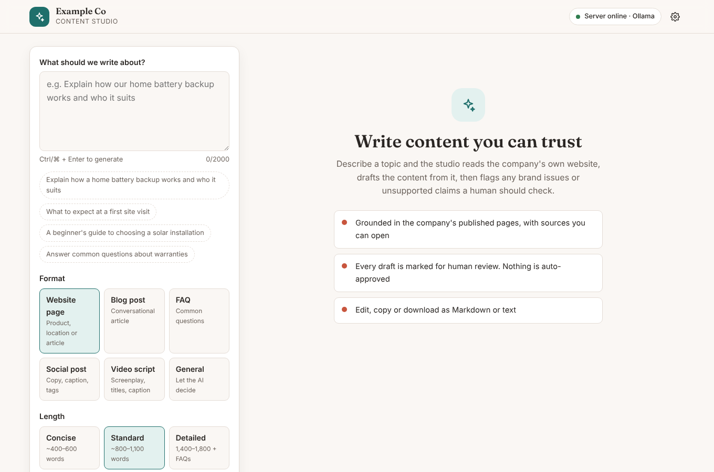
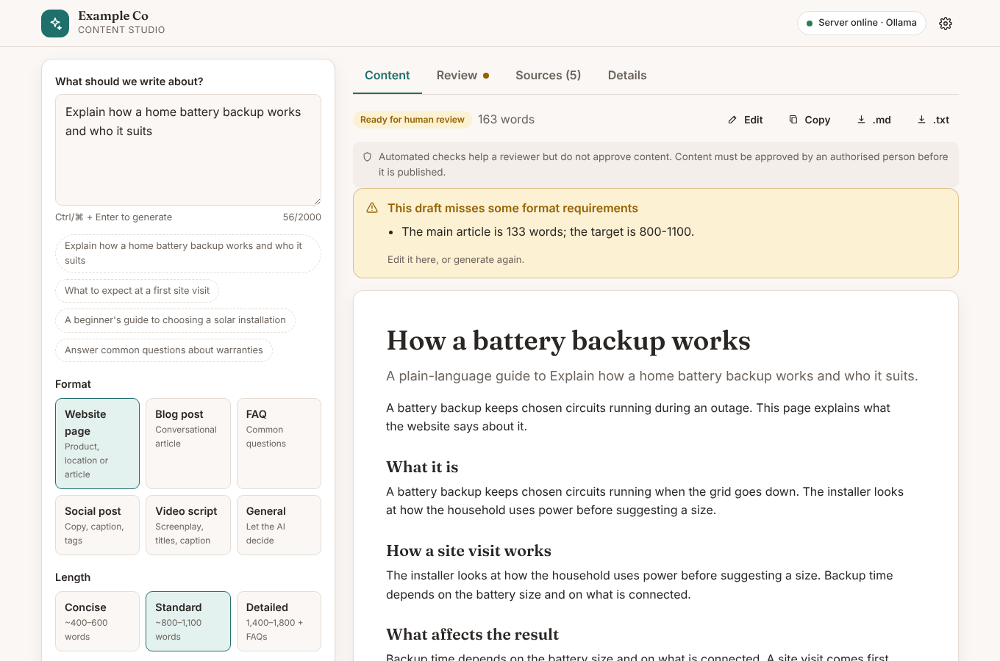
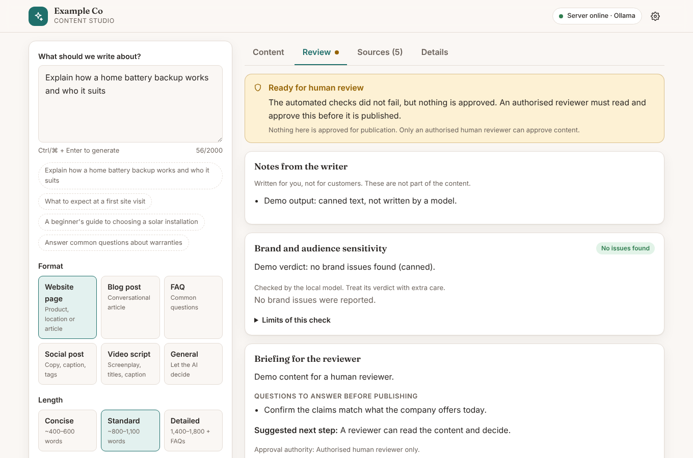
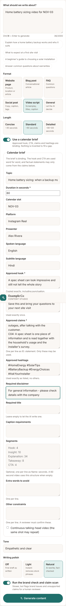
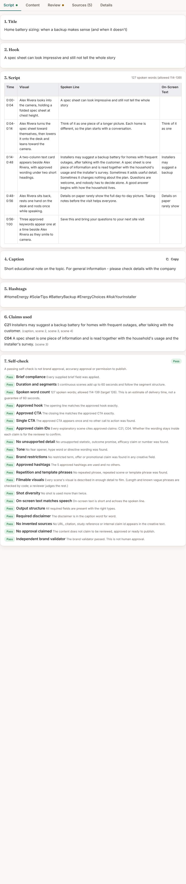

# 🧭 Grounded Content Studio

**A website-grounded content generation pipeline with built-in guardrails.** Point it at a company website and it researches the site, writes content only from what the site says, checks the result in code and with a brand validator, and hands a briefing to a human reviewer. It never approves or publishes anything.

> **New here? Follow the step-by-step [Setup guide (SETUP.md)](SETUP.md)** for requirements, Ollama, Claude, running it on your own computer and troubleshooting.
>
> This is a portfolio/demo project. "Example Co" is a fictional company, and the bundled demo mode uses a pretend website and a pretend model, so you can try the whole workflow with no API key.



---

## 📌 Overview

Grounded Content Studio is a **FastAPI + React** application. You describe what you want (a web page, blog post, FAQ, social post or video script), and a multi-stage pipeline does the rest:

1. **Reads the company website** and picks the pages most relevant to the request.
2. **Writes the content** with Anthropic Claude (or a local model through Ollama), forced into a strict output format.
3. **Checks the draft in code**: counts, lengths, invented statistics, offers, superlatives and claims about the company that the website does not support.
4. **Fixes and polishes** once, only if the result is verifiably no worse.
5. **Validates** with a brand validator, then prepares a **briefing for a human reviewer**.

The design rule behind all of it: *the model never grades itself.* Everything code can decide, code decides, and a model's "PASS" can be lowered by code but never raised.

---

## 🏗️ Architecture

```
Browser (React)  ──►  POST /api/v1/content/generate  (auth + rate limit)
                                  │
                                  ▼
┌──────────────────────────────────────────────────────────┐
│                      PIPELINE (app/agent.py)             │
│                                                          │
│  1. research_website   → rank pages, cache (research.py) │
│  2. generate           → strict JSON schema (llm.py,     │
│                           structured.py), Claude → Ollama│
│  3. check              → format + risky-claim scan       │
│                           (format_checks.py)             │
│  4. repair (once)      → kept only if strictly better    │
│  5. polish (optional)  → guarded rewrite (humanize.py,   │
│                           naturalness.py)                │
│  6. validate           → brand validator (validation.py) │
│  7. self-check         → 20 code checks for brief-driven │
│                           videos (selfcheck.py)          │
│  8. human review       → briefing, never an approval     │
└──────────────────────────────────────────────────────────┘
                                  │
                                  ▼
              Content · Review · Sources · Details tabs
```

| Module | File | Responsibility |
|---|---|---|
| Research | `app/research.py` | Homepage links and sitemap discovery, ranking, caching, language filtering |
| LLM layer | `app/llm.py` | Claude first, Ollama fallback, token budgets, forced structured output |
| Output formats | `app/structured.py` | Strict schemas for video, social, FAQ and detailed pages |
| Format and claim checks | `app/format_checks.py`, `app/fixes.py` | Counts, ranges, unsupported statistics, offers, superlatives, per-sentence fix suggestions |
| Natural-writing pass | `app/naturalness.py`, `app/humanize.py` | Removes stock phrases; a guard discards any rewrite that adds facts or breaks format |
| Content brief | `app/brief.py`, `app/selfcheck.py` | Binding calendar brief and 20 deterministic checks |
| Validation | `app/validation.py` | Brand validator, human-review briefing, fail-closed rules |
| Company profiles | `app/company.py` | Switch the studio to another company with a folder and one setting |
| Security | `app/security.py` | API keys and per-client rate limiting |

---

## ✨ Features

- **Grounded in the website**: sitemap-aware research, ranked and cached; facts about the company come only from its pages, with sources shown in the UI.
- **Strict output formats**: video, social, FAQ and detailed pages are generated field by field with counts built into the schema (for example exactly 15 hashtags), so a small local model cannot skip a part.
- **Claude with a local fallback**: `LLM_PROVIDER=auto | anthropic | ollama`; each failure is classified (`rate_limit`, `timeout`, `bad_output`, and so on) and reported.
- **Code-level claim scan**: flags invented percentages, guarantees, offers ("free consultation"), superlatives and unsupported statements about the company, then suggests a removal for each sentence with its own Apply and Undo button.
- **Guarded polish**: a natural-writing pass whose output is discarded if it adds a number or link, breaks the format, or strays in length. It makes no claim about AI-detector scores.
- **Calendar briefs**: an optional, binding content brief for presenter-led videos with exact hook and CTA, approved claim IDs, approved hashtags, segment timings and a word budget.
- **20-point self-check**: duration, word count, exact hook and CTA, single CTA, claim mapping, brand terms, hashtags, repetition, filmable visuals, shot variety, on-screen text, disclaimer, invented sources, no approval claims, and the brand validator.
- **Fail-closed review**: a validator error, a failed check or a missing guideline all block the review briefing. `publication_authorised` is always `false`.
- **Multi-company**: one folder per company holds its prompts and profile. Switching is `COMPANY=<id>`.
- **Tested**: hundreds of backend and frontend tests, with mocked models so none of them need a live service.

---

## 🖼️ Screenshots

| Content | Review |
|---|---|
|  |  |

| Calendar brief form | Brief-driven script and self-check |
|---|---|
|  |  |

*(Screenshots come from the offline demo, so the text is canned and short, and the format check correctly flags that the canned article is shorter than the requested length.)*

---

## 🖥️ Tech Stack

| Layer | Technology |
|---|---|
| Backend | Python 3.10+, FastAPI, Pydantic Settings |
| Research | HTTPX, BeautifulSoup, cachetools |
| LLMs | Anthropic Claude (forced tool use), Ollama (JSON-schema output) |
| Frontend | React 18, Vite 5 |
| Tests | pytest, pytest-asyncio, respx, Vitest |

---

## 📂 Project Structure

```
grounded-content-studio/
│
├── app/
│   ├── main.py             # FastAPI app and the generate endpoint
│   ├── agent.py            # The pipeline
│   ├── research.py         # Website research
│   ├── llm.py              # Claude / Ollama calls
│   ├── structured.py       # Strict output schemas
│   ├── format_checks.py    # Counts, ranges, risky-claim scan
│   ├── fixes.py            # Per-sentence fix suggestions
│   ├── naturalness.py      # Stock-phrase analysis and clean-up
│   ├── humanize.py         # Guard for the rewrite pass
│   ├── brief.py            # Content brief model
│   ├── selfcheck.py        # 20 deterministic checks
│   ├── validation.py       # Brand validator and review briefing
│   ├── company.py          # Company profiles
│   ├── security.py         # Keys and rate limits
│   └── config.py           # Settings
│
├── prompts/                # Every prompt is a plain, versioned file
├── companies/
│   └── example_company/    # profile.json and a sample brand guideline
├── demo/                   # Offline demo: pretend website and pretend model
├── frontend/               # React + Vite interface
├── tests/                  # Backend tests
├── docs/screenshots/
├── requirements.txt
└── .env.example
```

---

## ⚙️ Installation & Setup

*The short version is below. The full guide, with requirements, hardware notes, Ollama and Claude setup, LAN access and troubleshooting, is in [SETUP.md](SETUP.md).*

### Prerequisites

- Python 3.10+
- Node.js 18+ (for the web interface)
- *Optional:* an Anthropic API key, and/or [Ollama](https://ollama.com) for local models

### 1. Clone

```bash
git clone https://github.com/your-username/grounded-content-studio.git
cd grounded-content-studio
```

### 2. Install the backend

```powershell
py -m venv .venv
.\.venv\Scripts\Activate.ps1
pip install -r requirements.txt
Copy-Item .env.example .env
```

(macOS/Linux: `python3 -m venv .venv && source .venv/bin/activate && cp .env.example .env`.)

### 3. Build the web interface

```bash
cd frontend
npm install
npm run build
cd ..
```

---

## 🚀 Run

### Option A: offline demo (no API key, no Ollama)

```bash
python -m demo.run
```

Open http://127.0.0.1:8000. A pretend website (Example Co) and a pretend model answer with canned text, so you can click through every tab and the calendar-brief flow. **It shows the pipeline, not real writing quality.**

### Option B: with a real model

1. Set `WEBSITE_BASE_URL` in `.env` (or edit `companies/example_company/profile.json`).
2. Add `ANTHROPIC_API_KEY`, or use local models only:

```bash
ollama pull qwen2.5:7b      # must match OLLAMA_MODEL in .env
# in .env:  LLM_PROVIDER=ollama
```

3. Start the server:

```bash
uvicorn app.main:app --reload
```

- Web interface: http://127.0.0.1:8000
- API docs: http://127.0.0.1:8000/docs
- Health: http://127.0.0.1:8000/health

---

## 🧪 Usage

1. Type what you want written, choose a format and length.
2. Click **Generate content**.
3. Review the result:
   - **Content**: the draft, with format warnings, an edit mode, Markdown/text export, and a "copy text only" button.
   - **Review**: the brand check, the wording fixes (one Apply button per sentence), and the reviewer briefing.
   - **Sources**: the website pages the AI was given.
   - **Details**: timings, provider and fallback reason.
4. For a presenter-led video, choose **Video script** and switch on **Use a calendar brief** (see below).

### API example

```bash
curl -X POST http://127.0.0.1:8000/api/v1/content/generate \
  -H "Content-Type: application/json" \
  -H "X-API-Key: your-key" \
  -d '{"query": "Explain how a home battery backup works", "content_type": "article", "length": "standard"}'
```

Add `"validate_content": false` for a fast, unvalidated draft (`publication_status` is then `NOT_READY`).

---

## 🧠 How it works

### Research (`research.py`)
Discovers links from the homepage and the sitemap, ranks them by anchor text and URL against the request, fetches the best candidates concurrently (slow pages are abandoned), and ranks page text. Duplicate pages and translated copies are dropped. Pages and indexes are cached for `CACHE_TTL_SECONDS`.

### Generation (`llm.py`, `structured.py`)
Claude returns schema-shaped JSON through a forced tool call; on any failure the request falls back to Ollama. Formats with many required parts use strict schemas whose counts are part of the schema. Prompts live in `prompts/` as one file per format module, and the system prompt stays small enough for 7B local models.

### Checks (`format_checks.py`, `fixes.py`)
Verifies counts and word ranges and scans for wording the prompts forbid but small models still write: statistics the website does not contain, guarantees, offers, superlatives and statements about the company that share almost no vocabulary with the research. Findings trigger one repair pass (kept only if strictly better) and become per-sentence suggestions that only ever remove or weaken wording.

### Natural-writing pass (`naturalness.py`, `humanize.py`)
Three levels: off, light (instant clean-up of stock filler) and natural (a guarded AI rewrite plus the clean-up). The guard restores hashtags and fixed headings and rejects any rewrite that adds numbers or links, adds risky wording, worsens the format, or changes length too much. Reported measurements are editorial counts, not an AI-detector score.

### Brand validator and review (`validation.py`)
The brand validator runs on Claude first and Ollama second. Code-level checks can only make its verdict stricter (a PASS with no brand guidelines becomes REVIEW_REQUIRED). The human-review briefing is prepared only when the validator passed and no code check failed.

### Calendar briefs (`brief.py`, `selfcheck.py`)
For presenter-led videos the request may carry a binding `brief`:

```json
{"query": "Home battery sizing video", "content_type": "video_script",
 "brief": {"slot_id": "NOV-03", "duration_seconds": 60, "presenter": "Alex Rivera",
           "approved_hook": "...", "approved_cta": "...",
           "approved_claims": [{"id": "C21", "statement": "..."}],
           "approved_hashtags": ["#HomeEnergy"]}}
```

Required: `duration_seconds`, `approved_hook`, `approved_cta`, `approved_claims`. A missing field returns 422 and no model is called; nothing is invented to fill a gap. Optional: topic, platform, presenter, languages, subtitles, required title and disclaimer, caption requirements, segments, extra restricted words and constraints.

The self-check (`brief_report` in the response) decides in code: continuous scene times that add up to the duration, a spoken-word budget of `(duration - 5) x 2.3` words +/- 10 percent (an estimate, not a timer), exact hook and CTA, a single CTA, approved claim IDs only (the "Claims used" list is built by the application, not the model), unsupported numbers, brand terms in every creative field, exact hashtags, the disclaimer, repetition and template phrases, vague visuals, shot variety, on-screen text, invented sources, and no claim of approval. Any `FAIL` blocks the review briefing; `REVIEW_REQUIRED` and `UNVERIFIED` are never treated as a pass.

---

## 🏢 Writing for another company

Everything specific to a company lives in `companies/<id>/`, and prompts use placeholders (`{{company_name}}`, `{{website_url}}`, `{{audience}}`, `{{subject}}`) filled from the profile.

```bash
python -m app.company new acme --name "Acme Corp" --url https://www.acme.example/
# edit companies/acme/profile.json and companies/acme/prompts/*.txt
python -m app.company check acme
# in .env:  COMPANY=acme      (then restart)
```

`profile.json` holds the website address, the names shown on the page, example topics, `restricted_terms` (extra words banned in brief-driven scripts) and `risky_terms` (claims that must be backed by the website). A company other than the default never falls back to the shared prompts. `check` reports missing files, unknown placeholders, prompts without exactly one `Version:` line, output fields no prompt explains, and prompts too long for a small local model. Add the company's real guidelines as `companies/<id>/prompts/brand_guidelines.md`.

---

## 🔧 Configuration

Set in `.env` (see `.env.example` for all options):

| Setting | Meaning |
|---|---|
| `COMPANY` | Which folder under `companies/` to use |
| `WEBSITE_BASE_URL` | Overrides the profile's website |
| `LLM_PROVIDER` | `auto`, `anthropic` or `ollama` |
| `ANTHROPIC_API_KEY`, `ANTHROPIC_MODEL` | Claude settings |
| `OLLAMA_BASE_URL`, `OLLAMA_MODEL` | Local model settings |
| `API_KEYS`, `RATE_LIMIT_PER_MINUTE` | Access control (empty keys means no auth; local use only) |
| `FORMAT_REPAIR`, `HUMANIZE_ENABLED` | Turn the repair and polish passes on or off |

---

## ✅ Testing

```bash
pip install -r requirements-dev.txt
pytest                      # backend

cd frontend
npm test                    # frontend (Vitest)
```

Model calls are mocked, so the tests need no keys or network. `tests/test_demo.py` also runs the whole pipeline against the offline demo servers for every content type.

---

## ⚠️ Limitations

- It does not guarantee factual accuracy, and the code-level claim scan is a vocabulary check, not understanding. A human must review everything.
- Detector scores ("AI or human") are unreliable and are not a goal of this project.
- The demo uses canned text. Quality with a real model depends on the model and on the prompts you write for your company.
- Local 7B models follow the strict formats well but write less carefully than Claude.
- The rate limiter is in-memory and per process.

---
## Development Workflow

This project uses Git and GitHub to manage development and track changes.

### Contribution Process

1. Create a feature branch from `main`.
2. Make a focused and meaningful change.
3. Commit your changes with a descriptive commit message.
4. Open a Pull Request for review.
5. Merge the changes into the main branch after verification.


## 🤝 Contributing

1. Fork the repository
2. Create a feature branch (`git checkout -b feature/your-feature`)
3. Run the tests (`pytest` and `npm test`)
4. Commit and push your branch
5. Open a Pull Request

---

## 📄 License

MIT. See [LICENSE](LICENSE).

---

## 👤 Author

**Your Name**, [@your-github-username](https://github.com/your-username)

Built with FastAPI, React, Anthropic Claude and Ollama.
